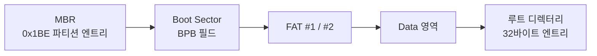
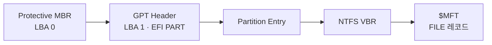

# 🔍 Forensics Parsers

**파일과 파일시스템 구조를 바이트 단위로 직접 따라가며 만든 포렌식 파서·복구 도구**


빡공팟(P4C) 15기 디지털 포렌식 과정에서 PNG·ZIP·FAT32·NTFS·EXT4·AVI/MP4의 구조를 공부하면서 만든 도구 8종입니다.
도구가 보여주는 결과를 그대로 믿기보다, **어느 오프셋에 어떤 필드가 있고 어떤 순서로 따라가야 다음 구조가 나오는지**를 직접 확인하는 것이 목표였습니다.

> **작업 방식**
> 필드 위치, 값의 의미, 데이터를 읽는 순서는 직접 분석해 파싱 흐름을 정했고, 코드 구현에는 AI를 활용했습니다.
> 각 도구의 출력은 HxD에서 확인한 헤더 필드·오프셋과 대조해 검증했습니다.

<br>

## 📦 도구 한눈에 보기

| 도구 | 대상 | 하는 일 |
|---|---|---|
| [`png_parser.py`](tools/png_parser.py) | PNG | 시그니처 확인, 청크 순회, 청크별 CRC 검증 |
| [`zip_parser.py`](tools/zip_parser.py) | ZIP | EOCD → Central Directory → Local File Header 순서로 파싱 |
| [`avi_mp4_parser.py`](tools/avi_mp4_parser.py) | AVI / MP4 | 시그니처로 형식 판별, MP4 박스·AVI 청크를 계층별로 출력, AVI 스트림 추출 |
| [`fat32_parser.py`](tools/fat32_parser.py) | FAT32 이미지 | MBR → Boot Sector → FAT 영역 → 루트 디렉터리 파일 목록 |
| [`ntfs_gpt_parser.py`](tools/ntfs_gpt_parser.py) | GPT + NTFS 이미지 | Protective MBR → GPT 헤더·파티션 엔트리 → VBR → $MFT 파일 목록 |
| [`ntfs_deleted_finder.py`](tools/ntfs_deleted_finder.py) | NTFS 이미지 | 삭제 플래그가 붙은 MFT 레코드에서 원래 파일 이름 추출 |
| [`ext4_deleted_recovery.py`](tools/ext4_deleted_recovery.py) | EXT4 이미지 | 삭제된 inode를 찾고 extent에서 실제 데이터 블록 위치 추출 |
| [`signature_carver.py`](tools/signature_carver.py) | 디스크 이미지 | JPG·PDF의 시작/종료 시그니처로 파일 카빙, 결과 보고서 생성 |

<br>

## 🧭 따라간 구조

도구마다 "어디서 시작해서, 어떤 값을 근거로 다음 위치를 계산하는지"를 정리했습니다.

<details>
<summary><b>PNG</b> — 시그니처 다음부터 청크가 반복된다</summary>

- 첫 8바이트 시그니처 `89 50 4E 47 0D 0A 1A 0A`로 PNG인지 확인
- 청크 구조: `Length(4) + Type(4) + Data(Length) + CRC(4)`
- CRC는 `Type + Data`로 다시 계산해 기록된 값과 비교 → 변조된 청크를 찾을 수 있음
- `IEND`가 나올 때까지 청크를 순서대로 따라감

</details>

<details>
<summary><b>ZIP</b> — 앞에서부터가 아니라 뒤에서부터 읽는다</summary>

- 파일 끝에서 EOCD 시그니처 `50 4B 05 06`을 거꾸로 찾음
- EOCD에 적힌 Central Directory의 위치·개수로 CD 엔트리(`50 4B 01 02`)를 읽음
- CD 엔트리에 적힌 오프셋으로 각 파일의 Local File Header(`50 4B 03 04`)로 이동
- 파일 이름, 압축 전후 크기, CRC-32를 CD와 LFH 양쪽에서 확인

</details>

<details>
<summary><b>FAT32</b> — 클러스터 번호를 섹터 위치로 바꾸는 계산이 핵심</summary>



- MBR 오프셋 446(0x1BE)부터 16바이트 파티션 엔트리 4개 → 파티션 시작 LBA
- Boot Sector에서 섹터 크기, 클러스터당 섹터 수, 예약 섹터 수, FAT 크기, 루트 디렉터리 클러스터를 읽음
- `FAT 시작 = 파티션 시작 + 예약 섹터`, `Data 시작 = FAT 시작 + FAT 크기 × 2`
- `클러스터 위치 = Data 시작 + (클러스터 번호 − 2) × 클러스터당 섹터 수`
- 디렉터리 엔트리 첫 바이트 `0xE5`는 삭제된 파일, 속성 `0x0F`는 긴 파일 이름(LFN) 엔트리

</details>

<details>
<summary><b>GPT + NTFS</b> — 파티션 테이블을 지나 $MFT까지 내려간다</summary>



- LBA 1의 GPT 헤더(`EFI PART`)에서 파티션 엔트리 시작 위치·개수·크기를 읽음
- 파티션 엔트리에서 시작/끝 LBA와 UTF-16 파티션 이름을 확인하고 `Basic data` 파티션을 선택
- VBR 오프셋 0x30의 $MFT 시작 클러스터 × 클러스터당 섹터 수로 $MFT 위치 계산
- MFT 레코드(1024바이트, `FILE` 시그니처)의 속성을 순회해 `$FILE_NAME`(0x30)에서 파일 이름 추출, `0xFFFFFFFF`가 나오면 속성 끝

</details>

<details>
<summary><b>NTFS 삭제 파일</b> — 지워져도 MFT 레코드는 남아 있다</summary>

- 이미지 앞부분에서 NTFS 시그니처를 찾아 VBR 위치를 확보하고 $MFT 위치를 계산
- MFT 레코드 오프셋 0x16의 플래그가 `0x00`이면 사용 중이 아닌(삭제된) 레코드
- 그 레코드의 `$FILE_NAME` 속성을 읽어 삭제된 파일의 원래 이름을 복원

</details>

<details>
<summary><b>EXT4 삭제 파일</b> — inode와 extent를 따라 데이터 위치를 찾는다</summary>

- 오프셋 1024의 슈퍼블록에서 블록 크기, 그룹당 inode 수, inode 크기를 읽음
- 그룹 디스크립터에서 inode 테이블 시작 블록을 찾음
- `i_dtime ≠ 0`, `i_links_count = 0`, 일반 파일 모드인 inode를 삭제 파일로 판단
- inode의 extent 헤더(매직 `0xF30A`)를 해석해 실제 데이터가 있던 블록 번호와 길이를 추출

</details>

<details>
<summary><b>AVI / MP4</b> — 크기 필드로 다음 블록 위치를 계산한다</summary>

- 헤더 12바이트로 AVI(RIFF)와 MP4(ftyp)를 구분
- AVI: `다음 청크 = 청크 시작 + 8 + 크기 + (크기 % 2)` — 2바이트 정렬 패딩까지 계산
- MP4: `다음 박스 = 박스 시작 + 박스 크기`, 크기가 1이면 64비트 largesize, 0이면 부모 박스(또는 파일) 끝까지
- 박스·청크를 계층별로 출력하고, AVI는 영상·음성 스트림을 분리해 추출

</details>

<details>
<summary><b>시그니처 카빙</b> — 파일시스템 정보 없이 시작과 끝으로 찾는다</summary>

- JPG `FF D8 FF` ~ `FF D9`, PDF `%PDF` ~ `%%EOF` 사이를 잘라 파일로 저장
- 찾은 위치·크기를 결과 보고서로 남김

</details>

<br>

## 💡 실제로 써 본 사례

**JPEG 뒤에 숨은 MP4가 7초에서 끊긴 이유 찾기**

JPEG 종료 시그니처(`FF D9`) 뒤에 MP4가 붙어 있는 문제에서, 추출한 10초짜리 영상이 7초에서 끊겼습니다.

1. `avi_mp4_parser.py`로 박스 구조를 출력
2. HxD에서 확인한 헤더 필드·오프셋과 파서 출력을 대조해 해석이 맞는지 검증
3. `mdat` 박스의 시작 오프셋 + 크기로 계산한 종료 지점이 **실제 파일 끝보다 앞선다**는 것을 확인
4. 그 뒤에 붙은 데이터 영역을 분리해 따로 조사

도구 출력만 보지 않고, 크기 필드로 계산한 위치와 실제 파일 길이가 맞는지 확인한 것이 단서가 됐습니다.

<br>

## ▶️ 사용법

Python 3 표준 라이브러리만 사용합니다. `avi_mp4_parser.py`의 AVI 스트림 추출만 ffmpeg가 필요합니다.

```bash
python tools/png_parser.py sample.png
python tools/zip_parser.py sample.zip
python tools/avi_mp4_parser.py video.mp4
python tools/fat32_parser.py fat32.vhd
python tools/ntfs_gpt_parser.py ntfs.img
python tools/ntfs_deleted_finder.py disk.001
python tools/ext4_deleted_recovery.py ext4.bin
python tools/signature_carver.py          # 실행 후 이미지 경로 입력
```

<br>

## 📝 참고

- 학습용으로 만든 도구라 손상이 심하거나 큰 이미지에서는 예외 처리가 부족할 수 있습니다.
- `ext4_deleted_recovery.py`는 첫 번째 블록 그룹(Group 0)만 검사하고, 삭제된 파일의 데이터 블록 위치까지 출력합니다.
- 코드 주석은 공부하면서 남긴 메모를 그대로 두었습니다.
